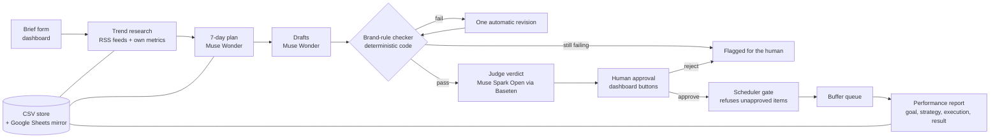

# PageOps Agent — Architecture

PageOps Agent is a digital marketing and content creation agent. It
runs a business page's weekly content operation end to end:
one brief in, a week of checked and approved posts out, with a human
approval gate that the code itself enforces. The demo brand is FYF AI.

## Shape: a small marketing company — one CEO, two departments, six roles

Each role's standing definition (its soul: what it owns, where it
stops, how it checks its own work, its skills, tools and model)
lives in `roles/`: ceo, strategist, copywriter, designer,
brand-checker, scheduler, analyst. Those files are the canonical
role definitions; this document describes how they are wired.

PageOps runs like a small digital-marketing company, not one
monolithic agent. A **CEO orchestrator** (`pipeline.py`) controls the
team: it assigns work down the pipeline, enforces the human-approval
gate, and consolidates the final report. Each role is a real position
with a JD scope (what it owns, where its authority stops), assigned
professional skills from evaluated marketing packs (reference only —
read, understood, then implemented in our own code), and its own
tools. The human owner sits above the CEO: the approval gate is the
owner's click, and no role can cross it.

**Layering.** Clean layers — CEO → two departments → roles →
pipeline stages — and only two kinds of connection: the CEO layer
(through its execution arm, the main orchestrator) calls a role, and
a stage hands its output to the next stage in sequence (through the
store). Roles never call each other; there is no peer-to-peer wiring
and no cross-stage link. The single cross-department connection is
the approval gate: Department 1's brand-checked drafts cross into
Department 2 only as the approved content package. Every connection
in the system is a named handoff in the tables below. In the code
this is literal: `pipeline.py` is the only place roles are invoked
from, and the store is the medium every handoff travels through.

**CEO — Orchestrator** (`pipeline.py`, code). JD: runs the week,
briefs each role in order, routes pass / revise-once / flag, holds
items at the gate, assembles the final report view. Stops: cannot
approve, cannot schedule, cannot invent numbers. Skills: Pocock
`grill-with-docs` + `to-spec`; gtm-fleet chief-of-staff roster
pattern. Tools: the store, the dashboard, the usage log.

In this codebase the CEO control layer and the main orchestrator are
two distinct layers of responsibility, both realised in the
orchestration layer: the **CEO** is the control function (assignment,
the approval gate on the dashboard, report consolidation and
sign-off); the **main orchestrator** is `pipeline.process_week`, which
executes the assignment through the roles in sequence and hands the
finished week back up. Layers: CEO → departments → roles → stages.

**Department 1 — Content Creation & Branding.** Decides what gets
said and how it sounds and looks: Research & Plan → Draft → Visuals → Check. It never
schedules or publishes; its finished product is the checked draft
package, handed up through the approval gate.

| Role | File | JD scope — owns / stops | Skills (reference) | Tools |
|---|---|---|---|---|
| Strategist / Researcher | `research.py`, `rss.py`, `pipeline.fetch_trends`, `pipeline.generate_week` | Owns trend + competitor research with sources, and the 7-day plan built on it. Stops: no final copy or visuals, no approvals. Self-check: every claim sourced; plan re-read against brand voice + own numbers | gtm-fleet `content-researcher`; Haines `customer-research` + `content-strategy`; gtm-fleet `campaign-plan` | Agent-Reach web search (optional, when the CLI is installed), RSS feeds (5) as the fallback, feedparser, page insights (read-only), metrics store, Meta Model API (Wonder) |
| Copywriter | `pipeline.draft_and_check` | Owns captions + hashtags in the brand voice, and the one revision. Stops: cannot pass or approve its own work. Self-check: drafts linted against voice rules + banned phrases before hand-up | Haines `copywriting` + `copy-editing`; owner's Burmese voice skills; social-media-skills | Meta Model API (Wonder), brand voice store |
| Graphic Designer | `designer.py` (stage being added, M21) | Owns visual production per post (posters, carousels, thumbnails) from brand templates. Stops: never freestyles off-template, writes no copy, redefines no brand assets. Self-check: template compliance (logo, colors, fonts) verified before hand-up | gtm-fleet `brand-designer` pattern; local poster-studio skill | Brand-assets layer (templates, logo, fonts), Meta Model API (Muse Image) inside templates |
| Brand Checker | `checker.py` + verdict step | The verify role: owns pass/fail per rule (banned phrases, no price/date promises, logo present) with quoted evidence + the model verdict. Stops: never edits, never approves; the rules live in the brand data. Self-check: a verdict without quoted evidence is invalid | gtm-fleet `brand-review`; Expert Panel pattern | Checker code, judge model verdict (Muse Spark Open via Baseten) |

**Brand-assets layer.** Department 1 owns the single brand source
every role consumes: colors, logo files, fonts, templates, voice
rules. Today that is the brand voice store plus the seed values in
the build package; when the owner's official FYF AI brand files
reach the workspace they load into this layer and replace the seed
in one swap. Department 2 consumes the layer read-only.

**Department 2 — Digital Marketing.** Gets approved content out and
measures what it did: Schedule → Report. It never creates or alters
content and works only on items that crossed the approval gate; its
finished product is the weekly performance report.

| Role | File | JD scope — owns / stops | Skills (reference) | Tools |
|---|---|---|---|---|
| Scheduler / Publisher | `scheduler.py` | Owns queueing and publishing approved posts + recording queue IDs. Stops: hard stop — refuses anything unapproved; cannot alter content. Self-check: refusal test + queue IDs read back | None assigned (packs do not cover scheduling) | Buffer API (dry-run until live) or Postiz, scheduler code |
| Performance Analyst | `metrics.py`, `report.py` | Owns the weekly report: metrics + ads analysis (goal → strategy → execution → result). Stops: numbers only from the metrics store and ads reads. Self-check: maths recomputed; every number traced to its source row | gtm-fleet `performance-report`; Haines `analytics`; Meta Ads set | Metrics code, insights + ads (read-only), Meta Model API (Wonder), Sheets mirror |

## Flow



## Components

| File | Role |
|---|---|
| `dashboard.py` | The only interface. Brief form, kanban board (Brief, Planned, Drafted, Checked, Awaiting approval, Scheduled, Reported), approve / edit / reject / schedule actions. Server-rendered, no build step. |
| `pipeline.py` | Orchestrates the stages: intake, trends, plan, draft-and-check with one revision, verdict. |
| `model_client.py` | Model access. `MetaModelClient` for the Meta Model API, an optional Baseten route for open weights, and `MockClient` so the whole system runs offline in tests. Every real call is written to a JSON-lines usage log. |
| `checker.py` | Deterministic brand-rule checks: the rules themselves (banned phrases, CTA markers, required hashtags) are read from the brand data; the enforcement is pure code. Platform length caps stay in code as platform facts. Every verdict quotes the draft's own lines as evidence. |
| `store.py` | CSV store that mirrors the Google Sheets schema (Brand Voice, Plan, Metrics). The board reads the same store the pipeline writes, so the UI is live truth. |
| `sheets_sync.py` | One-way push of the three datasets to Google Sheets for sharing and inspection. |
| `scheduler.py` | Scheduling gate plus Buffer client. `schedule_item` raises unless the item's status is `approved`; this is proven by an automated test. Buffer runs in dry-run mode until the live key is wired. |
| `metrics.py` / `report.py` | Deterministic performance maths and the report narrative, assembled only from computed numbers in goal, strategy, execution, result shape. |
| `rss.py` | Trend intake from curated feeds; every item keeps its source link. |
| `research.py` | Research backends for the Strategist: Agent-Reach web search first when the CLI is available, RSS as the fallback. The backend that answered (and the fallback reason, when one happened) is recorded in the trend notes. |

## Model routing

| Route | Models | Used for |
|---|---|---|
| Meta Model API (`api.meta.ai`) | Muse Wonder 1.0 (main), Muse Spark 1.3 (utility) | Plan, drafts, report narrative. `PAGEOPS_MAIN_MODEL` switches the main model for cheap dev iterations. |
| Baseten (`inference.baseten.co`) | Muse Spark Open (`meta-models/muse-spark-open-1026`, open weight) | The judge: brand verdicts at LOW reasoning effort, so a second model judges the main model's drafts (the verdict drives the deterministic pass / revise / flag routing in code). The same route also runs the pipeline on open weights for the open-weight comparison evidence. Enabled by `BASETEN_API_KEY`; without a key, verdicts fall back to the main client. |
| Mock | Canned outputs | Tests and offline development. The default mode; zero cost. |

## Trust and safety design

- **Approval is enforced in code, not in a prompt.** The scheduler
  refuses anything that is not approved, and a test proves it.
- **Deterministic core, model at the edges.** Rules, metrics maths
  and queue state are tested code; the model only writes and judges
  prose. Checker verdicts quote evidence instead of resting on the
  model's word.
- **One revision, then a human.** A failing draft is revised once
  with the checker's summary as feedback, then flagged rather than
  forced through.
- **Spend is observable.** Every API call lands in the usage log with
  its token counts, so credit burn is tracked against the balance.
- **Secrets stay out of the repo.** Keys come from the environment
  (`.env`, gitignored). No key, token or personal data is committed.
- **No native social posting APIs.** Scheduling goes through Buffer,
  which avoids platform app-review blockers and keeps a human-owned
  account in control of what actually posts.

## Data

Context architecture: roles never share context by chatting. There
is one store, in three layers. The **permanent layer** (brand voice
rows + brand assets: colors, logo, fonts, templates) is read-only
for all roles and updated only from the Branding side. The **job
layer** (brief, plan rows with their status fields, drafts, check
evidence, approval states, queue IDs) is owned by the CEO layer;
the dashboard renders exactly this layer, so the kanban statuses
are the shared context. The **private layer** is per-role working
memory (the Strategist's trend notes, the Analyst's performance
history). Handoffs are structured store objects moving through the
status machine, never free-text messages; the orchestrator routes
each role only the slice its JD needs. The Analyst's reports
persist and feed the Strategist's next plan. Every store write is
appended to a write log (who, when, field, old → new), which
doubles as the demo's audit evidence.

- Brand voice, plan and metrics live in the CSV store; the Google
  Sheet is a read-friendly mirror, never the source of truth.
- FYF AI's real baseline metrics (last 90 days to 31 Oct 2026: 15
  followers, 170 views across 3 posts, 13 engagements, 1 click) seed
  the metrics dataset, so the report stage works on honest numbers.

## Running it

```bash
./run_dashboard.sh  # dashboard on http://127.0.0.1:8765
.venv/bin/python -m pytest                      # test suite
PYTHONPATH=src .venv/bin/python scripts/verify_e2e.py  # end-to-end smoke checks
```

Set `MODEL_MODE=meta` with `MODEL_API_KEY` for real model calls;
leave it on `mock` for the offline demo. See the README for the full
setup and the smoke test.
