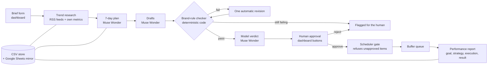

# PageOps Agent — Architecture

PageOps Agent is a digital marketing and content creation agent. It
runs a business page's weekly content operation end to end:
one brief in, a week of checked and approved posts out, with a human
approval gate that the code itself enforces. The demo brand is FYF AI.

## Shape: a small marketing company — one CEO, six roles

PageOps runs like a small digital-marketing company, not one
monolithic agent. A **CEO orchestrator** (`pipeline.py`) controls the
team: it assigns work down the pipeline, enforces the human-approval
gate, and consolidates the final report. Each role is a real position
with a JD scope (what it owns, where its authority stops), assigned
professional skills from evaluated marketing packs (reference only —
read, understood, then implemented in our own code), and its own
tools. The human owner sits above the CEO: the approval gate is the
owner's click, and no role can cross it.

**CEO — Orchestrator** (`pipeline.py`, code). JD: runs the week,
briefs each role in order, routes pass / revise-once / flag, holds
items at the gate, assembles the final report view. Stops: cannot
approve, cannot schedule, cannot invent numbers. Skills: Pocock
`grill-with-docs` + `to-spec`; gtm-fleet chief-of-staff roster
pattern. Tools: the store, the dashboard, the usage log.

| Role | File | JD scope — owns / stops | Skills (reference) | Tools |
|---|---|---|---|---|
| Trend Researcher | `rss.py`, `pipeline.fetch_trends` | Owns trend evidence with sources + the brand's own numbers. Stops: never picks topics or writes copy | gtm-fleet `content-researcher`; Haines `customer-research` | RSS feeds (5), feedparser, metrics store |
| Content Strategist | `pipeline.generate_week` | Owns the 7-day plan (topic, angle, format, platform, slot). Stops: no final copy, no approvals | Haines `content-strategy`; gtm-fleet `campaign-plan` | Meta Model API (Wonder), brand voice store |
| Copywriter | `pipeline.draft_and_check` | Owns captions + hashtags in the brand voice, and the one revision. Stops: cannot pass or approve its own work | Haines `copywriting` + `copy-editing`; social-media-skills | Meta Model API (Wonder), brand voice store |
| Brand Compliance Reviewer | `checker.py` + verdict step | Owns pass/fail per rule with quoted evidence + the model verdict. Stops: never edits, never approves; rules are code | gtm-fleet `brand-review`; Expert Panel pattern | Checker code, Meta Model API (Wonder verdict) |
| Distribution Coordinator | `scheduler.py` | Owns queueing approved posts + recording queue IDs. Stops: hard stop — refuses anything unapproved; cannot alter content | None assigned (packs do not cover scheduling) | Buffer API (dry-run until live), scheduler code |
| Performance Analyst | `metrics.py`, `report.py` | Owns the weekly report (goal → strategy → execution → result). Stops: numbers only from the metrics store | gtm-fleet `performance-report`; Haines `analytics` | Metrics code, Meta Model API (Wonder), Sheets mirror |

## Flow



## Components

| File | Role |
|---|---|
| `dashboard.py` | The only interface. Brief form, kanban board (Brief, Planned, Drafted, Checked, Awaiting approval, Scheduled, Reported), approve / edit / reject / schedule actions. Server-rendered, no build step. |
| `pipeline.py` | Orchestrates the stages: intake, trends, plan, draft-and-check with one revision, verdict. |
| `model_client.py` | Model access. `MetaModelClient` for the Meta Model API, an optional Baseten route for open weights, and `MockClient` so the whole system runs offline in tests. Every real call is written to a JSON-lines usage log. |
| `checker.py` | Deterministic brand-rule checks in pure code: banned phrases, CTA present, platform length caps, required hashtag. Every verdict quotes the draft's own lines as evidence. |
| `store.py` | CSV store that mirrors the Google Sheets schema (Brand Voice, Plan, Metrics). The board reads the same store the pipeline writes, so the UI is live truth. |
| `sheets_sync.py` | One-way push of the three datasets to Google Sheets for sharing and inspection. |
| `scheduler.py` | Scheduling gate plus Buffer client. `schedule_item` raises unless the item's status is `approved`; this is proven by an automated test. Buffer runs in dry-run mode until the live key is wired. |
| `metrics.py` / `report.py` | Deterministic performance maths and the report narrative, assembled only from computed numbers in goal, strategy, execution, result shape. |
| `rss.py` | Trend intake from curated feeds; every item keeps its source link. |

## Model routing

| Route | Models | Used for |
|---|---|---|
| Meta Model API (`api.meta.ai`) | Muse Wonder 1.0 (main), Muse Spark 1.3 (utility) | Plan, drafts, verdicts, report narrative. `PAGEOPS_MAIN_MODEL` switches the main model; verdicts always use Wonder on this route. |
| Baseten (`inference.baseten.co`) | Muse Spark Open (`meta-models/muse-spark-open-1026`) | Optional open-weights route. The same pipeline runs on Meta's open weights; used for the open-weight comparison evidence. Enabled by `BASETEN_API_KEY`. |
| Mock | Canned outputs | Tests and offline development. The default mode; zero cost. |

## Trust and safety design

- **Approval is enforced in code, not in a prompt.** The scheduler
  refuses anything that is not approved, and a test proves it.
- **Deterministic core, model at the edges.** Rules, metrics maths
  and queue state are tested code; the model only writes and judges
  prose. Checker verdicts quote evidence instead of resting on the
  model's word.
- **One revision, then a human.** A failing draft is revised once
  with the checker's summary as feedback, then flagged rather than
  forced through.
- **Spend is observable.** Every API call lands in the usage log with
  its token counts, so credit burn is tracked against the balance.
- **Secrets stay out of the repo.** Keys come from the environment
  (`.env`, gitignored). No key, token or personal data is committed.
- **No native social posting APIs.** Scheduling goes through Buffer,
  which avoids platform app-review blockers and keeps a human-owned
  account in control of what actually posts.

## Data

- Brand voice, plan and metrics live in the CSV store; the Google
  Sheet is a read-friendly mirror, never the source of truth.
- FYF AI's real baseline metrics (last 90 days to 31 Oct 2026: 15
  followers, 170 views across 3 posts, 13 engagements, 1 click) seed
  the metrics dataset, so the report stage works on honest numbers.

## Running it

```bash
./run.sh            # tests + smoke checks
./run_dashboard.sh  # dashboard on http://127.0.0.1:8765
```

Set `MODEL_MODE=meta` with `MODEL_API_KEY` for real model calls;
leave it on `mock` for the offline demo. See the README for the full
setup and the smoke test.
